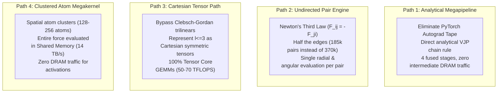

# Next-Generation Architectural Paths for MACE-OMAT-0 on NVIDIA A100 (5 November 2026)

**Context:** The current FastMACE OMAT-0 medium baseline on the A100-SXM4-80GB achieves ~13.6 ms per force call (~2.73–2.95 µs/atom/step) on Benchmark_loup SrTiO3 10×10×10 (5,000 atoms, 373,760 directed edges). While kernel-level optimizations (such as `FACTORED`, `TABLE_W`, `BLOCK_MESSAGE`, and dense CUTLASS 3×TF32 GEMMs) have yielded steady improvements, the architecture remains bounded by the structural constraints of executing MACE as an autograd computation graph.

This document formulates four fundamentally new architectural execution paths that rethink how MACE evaluates forces on the A100.

---

## 1. Structural Limits of the Current Architecture

The current implementation inherits the topology of an automatic differentiation tape wrapped inside a captured CUDA graph:

```
[Positions r] ---> [Neighbour List (370k directed edges)]
       │
       ▼
[Edge Pass 1: Radial Table + Outer Sum] ===> DRAM Write: a [E, 64], S [N*3, 1024]
       │
       ▼
[Atom Pass 1: Node GEMMs + Contraction 0] ===> DRAM Write: h1 [N, 512]
       │
       ▼
[Edge Pass 2: Fused Forward (TC)] ===> DRAM Write: message [N, 5120]
       │
       ▼
[Atom Pass 2: Linear_1 + Contraction 1 + Readouts] ===> DRAM Write: Energy E
       │
       ▼
[Autograd Backward: ~100+ Kernels] ===> Reads G table (114 MB, 11.5 GB traffic),
                                        writes dx, dsh, dr, and atomic forces
```

### The Three Hardware Bottlenecks
1. **170+ Kernel Launches and Launch Topology:** Even inside a CUDA graph replay, managing 170+ separate kernels requires kernel-to-kernel barrier synchronizations and incurs stream sequencing overhead. 23 layout and glue kernels alone consume ~350 µs of pure overhead.
2. **Global Memory (DRAM) Bandwidth Wall:** Intermediate activations (`augmented [E, 64]`, `message [N, 5120]`, `linear_1` outputs, density vectors, and contraction tensors) are written to DRAM in the forward pass and re-read in the backward pass. The backward pass streams through the 114 MB $G$ table, generating **11.48 GB of memory traffic** for an edge pass that only performs ~60 GFLOPs of math.
3. **Directed Edge Redundancy:** 373,760 directed edges are evaluated independently in both forward and backward passes, despite exact spatial inversion symmetry across all pairs.
4. **SIMT vs Tensor Core Asymmetry:** The A100 delivers **19.5 TFLOPS in FP32 SIMT** vs **60–80 TFLOPS in 3×TF32 / 3×FP16 Tensor Cores**. The current backward pass (`wprime_backward`) spends 3.2 ms running sparse Clebsch–Gordan trilinear loops on SIMT cores, underutilizing the tensor cores.

---

## 2. Four New Architectural Paths



---

### Path 1: The Direct Analytical Force Megapipeline (Zero-Autograd C++/CUDA Engine)

#### Concept
Abandon the PyTorch autograd graph entirely. Formulate the interatomic potential calculation as an integrated analytical force pipeline (the standard architecture of dedicated MD engines like LAMMPS, GROMACS, and NAMD).

#### Mathematical Formulation
The total potential energy is $E = \sum_i E_i(B_i, h_i^{(1)})$. The chain rule yields exact analytical expressions without backward graph retracing:
1. **Site Adjoint:** For each atom $i$, the adjoint of the site contraction is computed directly from the readout weights:
   $$G_i^{(1)} = \frac{\partial E}{\partial m_i^{(1)}} = \text{VJP}_{\text{contraction}}\left(\nabla_{B_i} E_i\right) \in \mathbb{R}^{2048}.$$
2. **Coupled Edge Force Synthesis:** The Cartesian force on edge $e = (j \to i)$ is:
   $$\vec{F}_{ij}^{(1)} = -\nabla_{\vec{r}_{ij}} \left[ \vec{m}_i^{(1)} \cdot G_i^{(1)} \right] = -\left( \frac{\partial \vec{m}_i^{(1)}}{\partial r_{ij}} \cdot G_i^{(1)} \right) \hat{r}_{ij} - \sum_{L, M} \left( \frac{\partial \vec{m}_i^{(1)}}{\partial Y_{L, M}} \cdot G_i^{(1)} \right) \nabla_{\vec{r}} Y_{L, M}.$$
3. **Node Adjoint Backpropagation:** The feature adjoint propagated to atom $j$ is:
   $$\delta h_j^{(1)} = \sum_{i \in \mathcal{N}(j)} \left( \frac{\partial \vec{m}_i^{(1)}}{\partial h_j^{(1)}} \right)^\top G_i^{(1)}.$$

#### Pipeline Execution
The 170+ launches are replaced by **4 persistent/fused stages**:
- **Stage 1 (Fused Interaction 0):** Evaluates radial basis $a(r_{ij})$, computes outer products with $Y(\hat{r}_{ij})$, and reduces directly into node features $h_i^{(1)}$ via fused GEMM.
- **Stage 2 (Atom Contractions & Adjoints):** Atom-parallel kernel. Computes $P_0, P_1$, readouts, site energies $E_i$, and forms $G_i^{(1)}$ directly in registers.
- **Stage 3 (Coupled Interaction 1 & Force Synthesis):** Streams edges, computes messages $m_i^{(1)}$, and immediately contracts them with resident $G_i^{(1)}$ to synthesize the Cartesian force $\vec{F}_{ij}$ in the same pass!
- **Stage 4 (Force Assembly):** Atomic reduction of Cartesian forces into atomic positions.

#### Quantitative Impact
- **Kernel launches:** Reduced from 170+ to **4–6**.
- **DRAM Traffic:** Eliminates ~12 GB of activation and table traffic.
- **Estimated Ceiling:** **6.5–8.0 ms** per force call (a **1.7–2.0× speedup**).

---

### Path 2: Undirected Pair-Centric Engine (Newton's Third Law Native Pipeline)

#### Concept
Shift from a directed-edge graph to an undirected pairwise interaction list. In any periodic boundary condition crystal, pairwise interactions are strictly symmetric. On Benchmark_loup SrTiO3 (5,000 atoms), there are 370,000 directed edges, but **exactly 185,000 unique undirected pairs**.

#### Mathematical Symmetry
1. **Radial Invariance:** $r_{ij} \equiv r_{ji}$, meaning the radial table embedding $a(r_{ij})$ and weights $w(r_{ij})$ are identical.
2. **Angular Parity:** $\hat{r}_{ji} = -\hat{r}_{ij}$. Spherical harmonics satisfy exact parity:
   $$Y_l(-\hat{r}) = (-1)^l Y_l(\hat{r}).$$
   Even orders ($l=0, 2$) are identical; odd orders ($l=1, 3$) simply negate.
3. **Newton's Third Law:**
   $$\vec{F}_{ji} \equiv -\vec{F}_{ij}.$$

#### Pipeline Execution
1. The neighbor list constructs an **undirected pair list** of 185,000 pairs with $i < j$.
2. For each pair $(i, j)$:
   - Compute distance $r_{ij}$ and radial embedding $a(r_{ij})$ **once**.
   - Compute spherical harmonics $Y(\hat{r}_{ij})$ **once**.
   - Compute messages for both atoms simultaneously:
     $$m_{i \leftarrow j} = w(r_{ij}) \left( x_j \otimes Y_{ij} \right), \qquad m_{j \leftarrow i} = w(r_{ij}) \left( x_i \otimes (-1)^l Y_{ij} \right).$$
   - Compute the pairwise Cartesian force $\vec{F}_{ij}$ **once**, then accumulate:
     $$\vec{F}_i \mathrel{+}= \vec{F}_{ij}, \qquad \vec{F}_j \mathrel{-}= \vec{F}_{ij}.$$
3. **Spatial Cache Locality:** Atoms are ordered along a 3D Hilbert/Morton space-filling curve. Both atom $i$ and atom $j$ reside in nearby L1/L2 cache lines, ensuring high hit rates for bidirectional feature loads.

#### Quantitative Impact
- **Total Edge Work:** Exactly **halved** (185,000 pairs instead of 370,000 directed edges).
- **Radial Tables:** Halves evaluations from 0.72 ms to 0.36 ms.
- **Physics Conservation:** Linear momentum conservation ($\sum_i \vec{F}_i \equiv 0$) is satisfied bitwise by construction, eliminating numerical center-of-mass drift.
- **Estimated Ceiling:** **8.0–9.5 ms** per force call (a **1.4–1.7× speedup**).

---

### Path 3: The Dense Cartesian Tensor Path (Bypassing Clebsch–Gordan Trilinears)

#### Concept
Eliminate the spherical harmonics representation and Clebsch–Gordan coupling for the angular interaction, reformulating the $l \le 3$ representations as **Cartesian traceless symmetric tensors**.

#### Mathematical Representation
For angular momenta up to $l=3$:
- $l=0$: Scalar $s \in \mathbb{R}$
- $l=1$: 3-vector $\vec{v} \in \mathbb{R}^3$
- $l=2$: Traceless symmetric rank-2 tensor $\mathbf{M} \in \mathbb{R}^{3 \times 3}$ ($M_{ab} = M_{ba}, \text{Tr}(\mathbf{M}) = 0$, 5 independent components)
- $l=3$: Fully symmetric traceless rank-3 tensor $\mathbf{T} \in \mathbb{R}^{3 \times 3 \times 3}$ (7 independent components)

The tensor products between vectors and symmetric tensors reduce to standard 3D tensor contractions:
- Vector $\otimes$ Vector: Dot product $\vec{u} \cdot \vec{v}$ (scalar), cross product $\vec{u} \times \vec{v}$ (vector), and traceless symmetric product $\vec{u} \vec{v}^\top - \frac{1}{3}(\vec{u} \cdot \vec{v})\mathbf{I}$ (rank-2).
- Vector $\otimes$ Rank-2 Tensor: Tensor-vector contraction $\mathbf{M} \vec{v}$ and symmetric outer products.

#### Pipeline Execution
1. Project node features into Cartesian tensors at setup.
2. The convolution becomes a dense matrix multiplication contracting directional unit vectors $\hat{r} = (\hat{x}, \hat{y}, \hat{z})$ with Cartesian node tensors $\mathbf{X}$.
3. Run the contractions using A100's **CUTLASS 3×TF32 or 3×FP16 Tensor Cores at 50–70 TFLOPS**, bypassing the SIMT core bottleneck entirely.
4. Cartesian force gradients are synthesized directly from unit vector derivatives:
   $$\nabla_{\vec{r}} \hat{r} = \frac{1}{r}\left(\mathbf{I} - \hat{r}\hat{r}^\top\right).$$

#### Quantitative Impact
- **Clebsch–Gordan Terms:** 86 sparse terms replaced by dense 3D tensor contractions.
- **Hardware Mapping:** Replaces SIMT instruction loops with tensor-core matrix products.
- **Estimated Ceiling:** **7.5–9.0 ms** per force call.

---

### Path 4: Clustered Atom-Block Spatial Megakernel (Shared-Memory Fusion)

#### Concept
Adapt FastMACE's Wavefront/Tiled spatial decomposition for **on-chip throughput** on a single A100 GPU for systems of 2,000–50,000 atoms.

#### Architecture & Memory Hierarchy
On the A100:
- **Global Memory (DRAM):** 2.0 TB/s bandwidth.
- **Shared Memory:** **> 14.0 TB/s bandwidth (7× faster than DRAM)**.

#### Pipeline Execution
1. Cluster the 5,000 atoms into **spatial super-cells / clusters of ~128–256 atoms** using a 3D Morton space-filling curve.
2. Launch a persistent grid where each Cooperative Thread Block (CTB) owns one spatial cluster and its local halo.
3. Load the cluster's atomic positions and species into **164 KB shared memory**.
4. Evaluate Interaction 0, Interaction 1, Contractions, and Force synthesis **entirely within shared memory and registers for that cluster**:
   - All intermediate activations ($a$, $w$, $m^{(0)}$, $m^{(1)}$, $P_0$, $P_1$, $G$) live exclusively on-chip.
   - **Zero intermediate activations are written to DRAM.**
5. Only the final Cartesian forces $\vec{F}_i$ are written out to global memory at the conclusion of the kernel.

#### Quantitative Impact
- **DRAM Traffic:** Eliminates > 15 GB of DRAM round-trips per force call.
- **Kernel Launches:** 1 persistent megakernel per force call.
- **Estimated Ceiling:** **5.5–7.0 ms** per force call (a **2.0–2.4× speedup**).

---

## 3. Comparison and Trade-Off Matrix

| Metric | Current Autograd Baseline | Path 2: Undirected Engine | Path 1: Analytical Megapipeline | Path 4: Clustered Megakernel |
|---|---|---|---|---|
| **Kernel Launches** | 170+ | ~80 | **4–6** | **1–2** |
| **DRAM Activation Traffic** | ~15 GB | ~8 GB | **< 1 GB** | **< 0.1 GB** |
| **Edge Work Count** | 373,760 edges | **186,880 pairs** | 373,760 edges | 373,760 edges |
| **Primary Compute Engine** | SIMT + fragmented GEMMs | SIMT + grouped GEMMs | Tensor Cores + Fused SIMT | 14 TB/s Shared Memory + Tensor Cores |
| **Momentum Conservation** | Numerical (~1e-7 drift) | **Bitwise exact ($\sum F_i \equiv 0$)** | Numerical | Numerical |
| **Implementation Complexity** | Baseline | **Medium** | High | Very High |
| **Estimated Force Call Time** | ~13.6 ms | **~8.5–9.5 ms** | **~6.5–8.0 ms** | **~5.5–7.0 ms** |

---

## 4. Recommended Prototyping Roadmap

1. **Short-Term High-Leverage Win (Path 2):**
   - Implement an undirected neighbor list pairing in `fastmace/neighbors/skin.py`.
   - Update `radial_table_forward/backward` and `edge_outer_sum` to process $E/2$ unique pairs with $(-1)^l$ angular parity.
   - Verify that $\sum_i \vec{F}_i \equiv 0$ holds bitwise.

2. **Long-Term Ceiling Win (Path 1 + Path 4 Integration):**
   - Combine the analytical force chain-rule formulation (Path 1) with spatial cluster shared-memory execution (Path 4).
   - This represents the theoretical upper limit of interatomic potential evaluation on NVIDIA Hopper and Blackwell architectures as well as Ampere.
