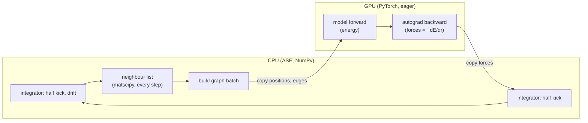
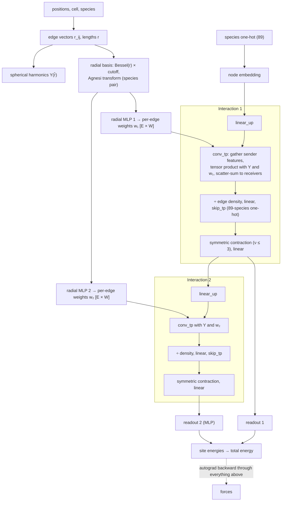
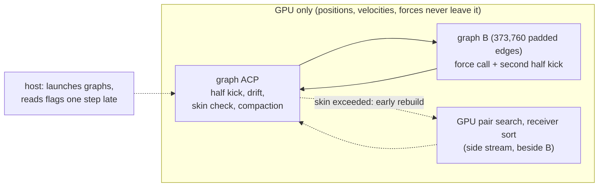
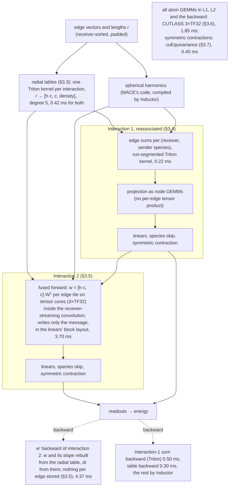
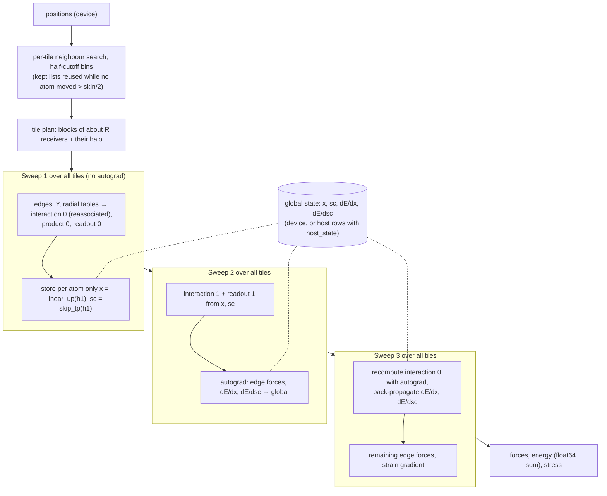
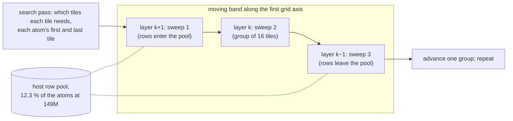
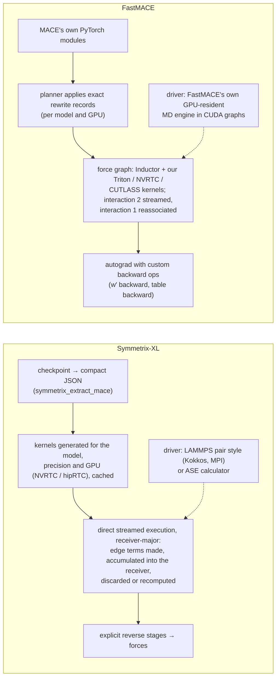

# How FastMACE runs OMAT-0, and where each part came from (4 November 2026)

**Three execution modes.** FastMACE runs OMAT-0 in three ways:
- **Whole-system** (§1–§3): one force call over all atoms, captured in CUDA graphs. This is the fast path for MD up to
  about 10⁵ atoms.
- **Tiled streaming** (§4): receiver tiles in three sweeps. This is the capacity path; the 1M-atom MD runs use it.
- **Wavefront tiled streaming** (§5): the same sweeps in a moving band of tiles. It holds the record of 149M atoms.

§6 compares FastMACE's architecture with Symmetrix-XL's. §7 lists the parts whose origin is not recorded.

**The whole-system run described.** §1–§3 describe the fastest OMAT-0 run recorded on `main`:
- **Record:** `results/omat0-a100-profile-20261104-4b70e3f2/` (source `4b70e3f2`, merged into `main` as `9ed7f559`).
- **Model and system:** MACE-OMAT-0 medium on a Modal A100-SXM4-80GB, Benchmark_loup's SrTiO3 10×10×10 (5,000 atoms),
  float32.
- **Protocol:** skin 0.5 Å, 1 fs (`tools/bench/loup_md.py`).
- **Speed:** NVE 2.73–2.97 µs/atom/step and Langevin 2.79–2.95 µs/atom/step, from three fresh processes each
  (`loup/*.json`). On 3 November, before the OMAT-0 kernel round, the same protocol gave 3.64 / 3.59
  (`results/omat0-a100-profile-20261103/`).

**Where each part came from.** Every part in §3–§5 carries one of four verdicts:

| Verdict | Meaning |
| --- | --- |
| **COPIED** | External code that we use or vendored. The source is named. |
| **EXTERNAL IDEA** | The idea came from outside (a project, paper, report or review); we wrote the code. |
| **OWN** | The records show that we came up with it, from our own profile, op map or derivation. |
| **UNCLEAR** | No record says where the idea came from. These are listed for investigation in §7. |

**How to read the citations:**
- `path:line` is a file in this repository.
- `RM:LT/path:line` is `Experiments/Langevin_Thermostat/path` in ResearchModule, read at main `d56b5550`.
- "RE" is the research engine in ResearchModule, from 7 to 16 October 2026. FastMACE was extracted from it.

## 1. How standard MACE runs MD

**The MD loop.** ASE drives the loop and calls `MACECalculator` once per step. The CPU and the GPU take turns, and
every step crosses PCIe twice:

**One force call** of a two-interaction model like OMAT-0 medium. Every arrow is one or more separate PyTorch kernels,
and every edge tensor is written to and read back from device memory. The backward then retraces the whole graph
through autograd:

## 2. How FastMACE runs MD

**The MD loop.** The whole step stays on the GPU. Each step replays two captured CUDA graphs:
- **ACP:** half kick, drift, skin check, and compaction of the edge list to the cutoff.
- **B:** forces and the second half kick.

The host only launches and reads flags. A neighbour-list rebuild, when the skin check asks for one, runs on a side
stream beside B. Everything outside the force graph costs about 0.08 ms of the 13.77 ms step
(`breakdown/summary.json`).

**One force call inside graph B** for OMAT-0 on the A100: 171 kernels and 13.7 ms. The numbers are milliseconds per
call from `breakdown/ops.csv`:

**What changed against standard MACE:**

| Standard MACE | FastMACE on this run |
| --- | --- |
| CPU integrator, one PCIe round trip per step | GPU-resident step in two CUDA graphs |
| matscipy neighbour list on the CPU every step | skin list on the GPU, rebuilt only when an atom has moved skin/2, beside the force call |
| Bessel basis + radial MLP per edge, twice | one table lookup per edge and interaction |
| Interaction 1: per-edge tensor product | sums per receiver and species, then node GEMMs |
| Interaction 2: `w₂ [E × 1280]` written, then read by the convolution | `w₂` computed on tensor cores inside the convolution's edge tiles, never stored |
| Backward of interaction 2 through `w₂` and the MLP | one kernel that rebuilds `w₂` and its slope from the radial table |
| cuEq linears and the 89-species `skip_tp` in FP32 | per-irrep GEMMs for the present species only, on 3×TF32 tensor cores |
| eager kernels | `torch.compile` (Inductor) inside our own graphs |

## 3. Each part in detail, and where it came from

### 3.1 MD loop and CUDA graphs

| Part | What it does | Verdict | Evidence |
| --- | --- | --- | --- |
| GPU-resident integrator | ASE's Langevin step term for term on GPU tensors, with the same random stream. | **UNCLEAR** | The RE built it on 7 October 2026. No document says where the idea came from. The earliest note is the RE's "The larger potential optimization is reducing repeated Python/kernel dispatch" (`RM:LT/docs/protocol.md:482`). Measured: NaCl 41.4 → 30.0 ms (`docs/optimisation-ledger.md:495`). |
| Our own CUDA graphs | Each step replays captured graphs. | **EXTERNAL IDEA** (PyTorch CUDA graphs) | The RE read about PyTorch's `reduce-overhead` mode (`RM:LT/docs/protocol.md:484`). That mode failed ("Every second step was 25–30× slower", `RM:LT/docs/implementation.md:160`), so the RE wrote its own capture. Measured: NaCl 30.0 → 16.5 ms, "the single largest step" (`RM:LT/studies/optimization_history/report.md:88`). |
| Padded edge counts in 5 % buckets | B is captured per padded edge count; padding edges lie beyond the cutoff and add exactly zero. There is one size here and no recapture. | **UNCLEAR** | The RE added it on 7 October 2026 (`docs/optimisation-ledger.md:498`). No source is cited. Padding to fixed shapes for CUDA graphs is common practice, so this may or may not be our own idea. |
| Pipelined steps | B is launched before the host reads the rebuild flags, and redone when a rebuild was needed. | **OWN** | Derived from our measured host gap: "The host gap of section 5 …" (`RM:LT/studies/further_optimizations/2026-10-14-third-round.md:229`). Measured: NaCl −3.0 % (`:255`). |
| Rebuild on a side stream (`overlap_rebuild`) | An early rebuild runs beside the force graph. | **OWN** | FastMACE OPT2-T04 diagnosis: "An early rebuild does not …" drain the stream (`docs/validation/opt2-T04.md:21`). |
| Fused integrator (Langevin only) | The Langevin ACP stage as 4 Triton kernels instead of about 45 PyTorch kernels. | **OWN** | FastMACE OPT3-T03, from the owner's "Go ahead and try all kernel opportunities" (`plans/opt-3.md:4-5`). The plan's in-kernel Philox and flags (`plans/opt-3.md:27`) resemble an outside chat's suggestion; that part was not built. |
| 256-step noise batches | One random draw and one copy per 256 steps. | **OWN** | From the RE's profile, where "the GPU waited for the CPU" (`RM:LT/studies/optimization_history/report.md:149`). |
| `torch.compile` mode `default` | Inductor fuses the elementwise chains inside our graphs. | **COPIED** (PyTorch Inductor) | Using it there was the RE's kernel-fusion "Idea 1" (`RM:LT/studies/kernel_fusion/report.md:1`). |
| `unfuse_full_addmm` | Keeps torch 2.14's Inductor from fusing mm + full add into `addmm`, which cost two device copies per step. | **OWN** | The RE's diagnosis on coraline (`docs/optimisation-ledger.md:242`). |

### 3.2 Neighbour list

| Part | What it does | Verdict | Evidence |
| --- | --- | --- | --- |
| Skin (Verlet) list | Pairs within cutoff + skin, rebuilt after skin/2 of displacement; each step compacts to the cutoff. | **EXTERNAL IDEA** (the standard Verlet list) | Textbook technique: "A Verlet skin list stores every pair closer than `cutoff + skin`" (`RM:LT/docs/implementation.md:108`). The 0.5 Å skin is Benchmark_loup's ([loup-a100.md](loup-a100.md):5), the same as Symmetrix-XL's default (`RM:LT/studies/symmetrix_xl/README.md:38`). |
| GPU pair search | One Triton kernel screens all sender × receiver tiles, with float64 pair decisions; the same pairs as matscipy. | **EXTERNAL IDEA, OWN CODE** | GPU rebuilds were raised in our own research prompt, with existing libraries as examples: "torch-nl, vesin, nvalchemi or NVIDIA Warp" (`RM:LT/studies/research_prompts/2026-10-09-hybrid-fp32-optimization-research.md:348-349`). The kernel is ours. Measured: step −1.6 to −4.6 % (`RM:LT/studies/further_optimizations/2026-10-14-third-round.md:64`). |
| Receiver-sorted edges | Edges are sorted by receiver at each rebuild. The streaming convolution and the segmented sum require it. | **UNCLEAR** | The idea first appears in an RE ideas list "proposed on 8 October" (`RM:LT/studies/remaining_optimizations/proposal.md:4`, `:250`). The list names no author. It was committed in a bulk reorganisation (ResearchModule `c733f69e`). |

### 3.3 Radial network → radial tables

| Part | What it does | Verdict | Evidence |
| --- | --- | --- | --- |
| Radial tables (`generic_radial_tables`) | Per interaction and species pair, piecewise Chebyshev series fitted in float64 at setup replace the whole chain r → `[h·c, c, density]` (Bessel, Agnesi, MLP, cutoff). A setup certificate requires the table's float32 error to be at most the float32 network's. | **OWN** | The "external proposal" of 27 October (`docs/validation/opt6-T04.md:21`) was a Claude research session that the owner ran on another account; the chat is kept in [2026-10-27-radial-tables-proposal.md](../design/2026-10-27-radial-tables-proposal.md). **That session found the design itself:** it calls it "The most radical lever I found" and cites no outside source. The design is per species pair, piecewise Chebyshev, on the folded layer's 65-wide input, with the certificate "refuse if the ratio exceeds 1". Its NumPy scripts are in `results/opt6-T04-radial-stub-20261027/table-check/`. **Not copied from the outside spline idea:** Symmetrix-XL uses "cubic Hermite splines (256 knots)" (`RM:LT/studies/symmetrix_xl/README.md:20`), and an outside report proposed a 512-knot Hermite spline. The session tested that spline and rejected it: its r-derivatives were 1.4–34× worse than the float32 network. The OMAT-0 version is a FastMACE finding ("The one worth building", `docs/validation/tiled-omat.md:164`). Measured on the A100: 0.902 / 0.901 ([loup-a100.md](loup-a100.md):46). |
| Degree-5 table pieces | Chebyshev degree 5 instead of 10, with more pieces at the same tolerance and certificate: fewer terms per edge in the table, its backward and the w′ slope. | **OWN** | From our OMAT-0 screen: "Degree 5 tables are the largest gain on every GPU (−7 to −10 %)" (`results/omat0-kernel-lab-20261103/README.md:114`). Default since 4 November (`fastmace/rewrites/radial/__init__.py:41-45`): MD step 0.903 / 0.905 on the A100-SXM4-80GB. |

### 3.4 Interaction 1, reassociated

| Part | What it does | Verdict | Evidence |
| --- | --- | --- | --- |
| Reassociation (`generic_reassociate`) | Interaction 1's input is species-only. Its messages are summed per (receiver, sender species) before the last radial layer, then projected with node GEMMs. This removes the first convolution and its per-edge weights. | **EXTERNAL IDEA, OWN CODE** | From an external research report (GPT-6 Pro): "move the first interaction's final radial projection after a receiver-and-species aggregation" (`ResearchModule:GPT_6_PRO_RESEARCH_2.txt:1`), assessed in `RM:LT/studies/research_prompts/2026-10-10-hybrid-default-further-optimization-assessment.md:55`. Measured: NaCl 4.9 %, NaNbO3 7.2 %, NbCl5 4.9 % (`RM:LT/studies/further_optimizations/README.md:55`). |
| Segmented sum (`segmented_first_sum`) | Those sums run as a run-segmented Triton kernel, one atomic per run. | **UNCLEAR** (idea); **OWN** (kernel) | The general idea, "Receiver-sorted edges and segmented aggregation", is in the same unattributed 8 October list (`RM:LT/studies/remaining_optimizations/proposal.md:242`). The concrete kernel is the RE's third-round candidate (`RM:LT/studies/further_optimizations/2026-10-14-third-round.md:45`). |

### 3.5 Interaction 2: streaming convolution, fused forward, w′ backward

| Part | What it does | Verdict | Evidence |
| --- | --- | --- | --- |
| Receiver-streaming convolution kernels | One writer per receiver, with no atomics in the forward; compiled with NVRTC. | **COPIED** (OpenEquivariance PR 223, after the Sobek paper) | Vendored from "OpenEquivariance pull request 223 … by Paul Fuchs", which "adapts the streaming schedule of Chorošajev and Bény, Sobek" (arXiv 2607.18074) (`fastmace/kernels/oeq_streaming/NOTICE.md:3-8`). The owner pointed at the PR (`RM:LT/studies/symmetrix_xl/STREAMED_EDGES_RESULTS.md:121`). Our change is the `ir_mul` layout (`NOTICE.md:12-15`). |
| Fused forward (`generic_fused_folded_forward`) | `w = [h·c, c]·[W, b]ᵀ` is computed per edge tile inside the streaming convolution, instead of an `[E × 1280]` tensor written and read back. | **EXTERNAL IDEA** (Symmetrix-XL), **OWN CODE** | "Origin: the one idea from Symmetrix-XL" (`RM:LT/studies/symmetrix_xl/STREAMED_EDGES.md:7`). The idea "computes `w[e]` from `a[e]` inside the kernel" (`:27-28`). Our kernel is generated from the streaming schedule (round 8, "Owner request", `plans/opt-8.md:3`). On the A100 it is used only together with the w′ backward, because alone it is slower (1.289; pair 0.885, `docs/validation/generic-wprime.md:58`, `:71`). |
| Tensor-core fused forward (`fused_forward.TENSOR_CORES`, mask split) | The `[h·c, c]·Wᵀ` product of the fused forward in 3×TF32 `mma.sync` tiles. The TF32 high and low parts are split by masking instead of rounding, which our kernel lab found to be where the time went. | **EXTERNAL IDEA** (3×TF32, §3.6), **OWN** kernel and split | Our first version lost on every GPU, because the split costs "about as much ALU work as the FP32 product it replaced" (`results/omat0-kernel-lab-20261103/README.md:119-120`). The lab then traced the time to the split (`:250-253`). The mask split followed. Default on the A100s (owner "Yes to both", `:320-322`): MH-1 step 0.97–0.98 (`:326-327`); Benchmark_loup on the A100 80GB PCIe 3.12 / 3.09 µs/atom/step (`:354`). |
| Skip the zero bias column | The fused forward's k-loop skips the folded weight's all-zero last column. | **OWN** | Built from the kernel lab (`results/omat0-kernel-lab-20261103/README.md:71`); adds 1–2 % on top of degree 5 on the Ada and the A100 (`:117`). |
| w′ backward (`generic_wprime_backward`) | Within a table piece, `w(r) = Σ_t T_t(x) G_t`. The backward forms `dr = Σ_c dw_c · w′_c(r)` from derivative tables: 6 instead of 65 multiply-adds per weight at degree 5, with no stored weight gradient and no radial backward. | **OWN** | Derived in our own ideas session: "`dr = Σ_c dw_c · w'_c(r)`" (`plans/ideas-20261027.md:57`; "Side session \"fm-ideas\"", `:3`). The float32 form was an "Owner request, 28 October 2026" (`plans/opt-9.md:3`). It depends on the radial tables (§3.3). |
| w from the table (`wprime_backward.TABLE_W`) | The w′ backward rebuilds w and its slope from one slab of the value table, so the forward no longer stores `w [E × 1280]` (1.9 GB per call). | **OWN** | From our A100 profile and kernel-lab falsifiers, which put 13–22 % of the forward and 9–17 % of the backward on the w store (`results/omat0-kernel-lab-20261103/README.md:440-443`). MD step 0.943 / 0.943 on the A100-SXM4-80GB; default owner, 4 November (`:480`). Not storing w was the goal of Symmetrix-XL's streamed edges (`RM:LT/studies/symmetrix_xl/STREAMED_EDGES.md:27-28`); rebuilding it from our tables is our own route. |
| Message in the linears' block layout (`wprime_backward.BLOCK_MESSAGE`) | The forward writes interaction 2's message straight into `linear_1`'s per-irrep blocks, and the backward reads the gradient the same way; the relayout copies around `linear_1` go. | **OWN** | From our `TABLE_W` step breakdown: "about 1.15 ms per step … in relayout copies around linear_1" (`results/omat0-kernel-lab-20261103/README.md:486`). A100-SXM4 0.983 / 0.977; default on the RTX 4000 Ada and the A100s (owner, `:499-500`). |

### 3.6 Atom-level linear layers and GEMM precision

| Part | What it does | Verdict | Evidence |
| --- | --- | --- | --- |
| Per-irrep block GEMMs (`block_linear`) | cuEq `Linear` becomes per-irrep GEMMs with extracted weights. | **OWN** | From the RE's op map, where cuEq's linears were "using slower kernels" (`RM:LT/studies/further_optimizations/2026-10-14-third-round.md:100`). Measured: NaCl −11.8 % (`:117`). |
| Grouped products (`grouped_linear`) | Same-irrep input segments share one product. | **OWN** | The RE's answer to the owner's "optimize OMOL-0 further" (`RM:LT/studies/other_models/README.md:652`, adopted `:721`). |
| Species-restricted skip (`species_skip`) | The `skip_tp` over 89 one-hot elements becomes one GEMM per irrep block for the species present. | **OWN** | From the RE's step breakdown: "about 97% of this multiplies by zero" (`RM:LT/studies/other_models/README.md:282`). Measured on OMAT-0: −20 to −39 % (`:318`). |
| 3×TF32 GEMMs on CUTLASS (`tf32x3_gemms`) | All of the above GEMMs run as error-compensated 3×TF32 on tensor cores, through a prebuilt CUTLASS cubin. Shapes outside the rule stay on cuBLAS IEEE. | **COPIED** (CUTLASS kernel); **EXTERNAL IDEA**; **OWN** integration and shape rule | The kernel is "the 3xTF32 split of CUTLASS example 27" (`fastmace/kernels/cutlass/NOTICE.md:6`). The idea reached us through an external research report, "3×TF32 is worth testing" (`docs/design/2026-10-20-megakernel-research.md:152`), and an external review that started the 29 October screen (`docs/validation/tc-gemm-screen.md:4`). Then: "build it for a100" (`docs/validation/cutlass-tf32x3.md:3`). Measured on OMAT-0: 0.949 / 0.947 (`:86`). |

### 3.7 Backend, symmetric contraction, precision

| Part | What it does | Verdict | Evidence |
| --- | --- | --- | --- |
| Hybrid cuEq + OEq backend | OpenEquivariance for the convolution; cuEquivariance for the symmetric contraction and the rest. | **COPIED** (MACE 0.3.16, OEq, cuEq) | "MACE 0.3.16 can run a model with two accelerated backends at once" (`RM:LT/studies/remaining_optimizations/proposal.md:96`). Adopting it was the user's decision of 9 October (`RM:LT/docs/status.md:7`). |
| Symmetric contraction | cuEquivariance's kernel, unchanged (0.40 ms). | **COPIED** (cuEquivariance) | No rewrite. |
| Float32 with TF32 off, energy summed in float64 | The precision policy; 3×TF32 (§3.6) is the only tensor-core use. | **OWN** (decision) | User production decision, 9 October (`RM:LT/docs/status.md:7`). |

**Not on the A100:** the species GEMM (`SPECIES_GEMM`, every atom's skip-product rows through its own species'
matrix) is a default only on the RTX 5060 Ti and RTX 4000 Ada (owner, `results/omat0-kernel-lab-20261103/README.md:409`). On the A100-SXM4-80GB
it measured 0.992 / 0.991, and 0.993 / 0.992 as a gathered CUTLASS kernel (`:381`, `:418`).

**On in the plan but doing nothing in this run** (no kernels):
- `fused_folded_backward` and `chunked_conv_backward` are on only as prerequisites of §3.3 and §3.5
  (`fastmace/planner/fixed.py:1218`).
- `merged_residual`: "this record stays off" for this model (`breakdown/summary.json:394`).
- `single_graph_strain`: acts only where stress is computed, and this fixed-cell run computes none.

## 4. Tiled streaming (capacity mode)

**What it is for.** Whole-system MD keeps every edge intermediate of the force call in device memory, so OMAT-0 stops
at about 69k atoms on a 20 GB RTX 4000 Ada (`docs/validation/tiled-1m-speed.md:89`). The tiled path bounds every
intermediate by a tile. The best tiled MD run has 975,560 atoms (leto, RTX 4000 Ada, R = 16,384, NVE): 14.87 s per
step, about 15.2 µs/atom/step, with a drift of 0.033 meV/atom (`docs/validation/tiled-1m-speed.md:204`).

**How it is run.** The planner never chooses this path. Runs go through `tools/bench/tiled_capacity.py` and
`tools/bench/tiled_md.py`. The automatic rule that `docs/design/tiled-backend.md:221-229` proposed is still an open
owner decision.

**How one force call works** (`fastmace/model/tiled.py`, `_call`):
- **Tile plan.** Atoms are binned on a block grid of fractional coordinates. Each block holds about R receivers
  (R = 4,096, 8,192 or 16,384, whichever the workspace budget allows).
- **Tile graph.** A tile is `[receivers, halo]`, MACE's own LAMMPS ghost layout, so MACE's interaction code runs
  unchanged and cuts its outputs to the receivers.
- **Inside a tile,** the whole-system rewrites of §3 run (§4.3).
- **Three sweeps** go over all tiles. Only two node arrays and their gradients are kept for all atoms.

### 4.1 The tiling itself

| Part | What it does | Verdict | Evidence |
| --- | --- | --- | --- |
| Receiver tiles, three sweeps, only inter-layer state global | Every intermediate is bounded by a tile; three sweeps reuse one workspace. | **EXTERNAL IDEA** (Symmetrix-XL's tiled mode), **OWN CODE** | "after an outside review pointed at Symmetrix-XL's tiled mode" (`docs/design/tiled-backend.md:4`). The design summarises arXiv 2610.01036 §5 and §7.2: "Three sweeps" over tiles of at most 8,192 receivers, with only H₁ and its adjoint global (`:25-29`). Neither the review nor the paper is kept in the repository. |
| Tile = MACE's LAMMPS ghost layout | `[receivers, halo]` nodes, so the interactions run unchanged. | **OWN** mapping onto MACE's code | "This is exactly MACE's LAMMPS ghost layout." (`docs/design/tiled-backend.md:65`) |
| Why three sweeps suffice for OMAT-0 | Interaction 0's senders are species-only, so all edges an atom's h1 needs are in its own tile. | **OWN** derivation | "Interaction 0's senders are species-only" (`docs/design/tiled-backend.md:84`) |
| Global `x = linear_up(h1)` and `sc = skip_tp(h1)` instead of h1 | Keeps interaction 1's two reads of h1 and recomputes h1 in sweep 3. | **EXTERNAL IDEA** "free h1" (an outside idea list); **OWN** form | The outside list item is in `plans/capacity-ideas-20261030.md:3`, `:39`. Ours: "The plan's T2 would not lower the peak." (`docs/validation/capacity-tiled-t1t2.md:10`); global state 17 → 4.75 kB/atom (`:28`). |
| Spatially compact tiles | Blocks of a fractional-coordinate grid, split above R. | **OWN** | "So tiles must be spatially compact." (`docs/design/tiled-backend.md:142`) |
| Edge forces and stress per tile | `F[r] −= g`, `F[s] += g` from edge-vector gradients; stress from the strain of the edge vectors. | **COPIED** method (MACE's `compute_edge_forces`); **OWN** stress derivation | "These are MACE's edge forces (`compute_edge_forces`)" (`docs/design/tiled-backend.md:165-166`); the stress is "the same linear map that MACE's `get_symmetric_displacement` applies" (`:169`). |
| Padded slots per edge bucket | Fixed (R, halo, edges) shapes; padding adds exact zeros. | **OWN** | "Each tile is padded to fixed (R, H, Ec)" (`docs/design/tiled-backend.md:186`), written before the outside list repeated it (`plans/capacity-ideas-20261030.md:41`). |
| Compiled tile bodies, `auto` mode | Each sweep's forward compiled by Inductor per slot; the first call runs eagerly and measures memory, and later calls are compiled if they fit. | **OWN** | "The tile body is GPU-bound, so the remaining lever was Inductor" (`docs/validation/tiled-compiled.md:4`). |
| Receiver cap from the memory budget, with an out-of-memory retry | The largest R that fits; on an out-of-memory error, plan again at the next lower cap. | **OWN** | "R is not fixed at 16,384 but driven by a budget." (`docs/validation/tiled-r-budget.md:4`); retry: `docs/validation/tiled-omat.md:115`. |

### 4.2 Neighbour lists, host memory and build

| Part | What it does | Verdict | Evidence |
| --- | --- | --- | --- |
| Per-tile neighbour search | No global list; each tile searches its own edges, bitwise the global list's. | **EXTERNAL IDEA** (an outside idea list), **OWN CODE** | "Per-tile neighbour storage" (`plans/capacity-ideas-20261030.md:116`); "the list-build tiling of the seventh list" (`fastmace/neighbors/tile_list.py:2`). |
| One-byte shift codes, narrow counts | Compact cached lists. | **EXTERNAL IDEA** (same list) | "one-byte shift code" (`plans/capacity-ideas-20261030.md:117`); built in `docs/validation/tiled-cache-compact.md`. |
| Lists once per call (sweeps 2 and 3 reuse sweep 1's) | A per-call list cache. | **OWN** | From our profile: "the first two levers it showed" (`docs/validation/tiled-speed.md:9`). |
| Kept lists across calls | Lists within cutoff + skin, reused until an atom moves skin/2. | **EXTERNAL IDEA** (the standard Verlet rule); **UNCLEAR** who proposed it here | "That is the whole-system list's rule (`SkinNeighbourList`)." (`docs/validation/tiled-list-reuse.md:21`) |
| Half-cutoff bins, int16 sender ranks, chunked skin check | Faster and smaller search at 1M. | **OWN** | From our 1M profile (`docs/validation/tiled-1m-speed.md:193-201`). |
| Host state (`state="host"`) | x, sc and their gradients on the host; each tile copies its rows. | **EXTERNAL IDEA** (outside idea list) | "Host-staged h1 and dh1 in pinned memory" (`plans/capacity-ideas-20261030.md:41`) |
| Pageable instead of pinned host memory | Avoids PyTorch's power-of-two pinned rounding. | **OWN** | "a third of it was PyTorch's pinned-memory rounding" (`docs/validation/tiled-host-memory.md:6`) |
| Aliased host state | dE/dsc overwrites sc's row, dE/dx overwrites x's row once no tile needs it. | **OWN** (another FastMACE session) | "The neighbour-list session's proposal, through the conductor" (`docs/validation/tiled-alias.md:3`) |
| Deferred host writes | Host indexing overlaps the next tile. | **OWN** | Our profile "puts this at 10 % of a compiled call" (`docs/validation/tiled-overlap.md:5`). |
| Species index instead of one-hot; species tables at tile rows | Device memory per atom down. | **OWN** | Memory snapshot: the one-hot "on the device twice" (`docs/validation/tiled-onehot.md:5`); "The conductor's option" (`docs/validation/tiled-table-rows.md:3`). |
| Build without MACE's neighbour search; build trims | The whole-system build intermediates are removed. | **OWN** | "set by a list nothing used" (`docs/validation/tiled-omat.md:72`); "three changes" (`docs/validation/tiled-build.md:4`). |

### 4.3 The whole-system rewrites inside the tiles

Inside the tiles, OMAT-0 runs these rewrites from §3 (recorded in the 149M runs' JSONs):
- the radial tables (tiled step 0.86–0.91, `SPEC.md:476`);
- the reassociated interaction 0 with the segmented sum;
- the streaming convolution and the chunked convolution backward, with ×4 chunks on the RTX 5060 Ti and
  RTX 4000 Ada;
- block and grouped linears, the species skip, and the fused radial backward.

Their origins are those of §3. Not active in the tiles: 3×TF32 (an A100 default), and the fused forward with the
w′ backward.

## 5. Wavefront tiled streaming (149M atoms)

**The record.** 148,955,000 atoms of SrTiO3 (310×310×310) on murphy (RTX 4000 Ada 20 GB, 251 GiB host memory):
- **Edges:** 11,022,670,000 (74 per atom); largest force component 1.3 meV/Å.
- **First run** (R = 4,096): compiled call 3,457 s, 23.2 µs/atom; GPU peak 16.9 GiB; host peak 139.5 GiB
  (`docs/validation/tiled-wavefront.md:74-85`).
- **Rerun** at R = 8,192: compiled call 2,947 s, 19.8 µs/atom (`:89-94`).

These are single force calls, not MD steps.

**What changes against §4.** Only the order of the sweeps and where the state rows live:
- **The problem.** With the plain three sweeps, x, sc and their gradients for all atoms must sit in host memory for
  the whole call. At about 65M atoms that no longer fits.
- **The schedule.** The wavefront orders the tiles along one axis of the grid. It runs sweep 2 on a group of tiles,
  sweep 1 just before on the tiles that group needs, and sweep 3 as soon as nothing later needs a tile.
- **The effect.** Only a band of a few tile layers holds state; its rows come from a pool that atoms enter at
  sweep 1 and leave after sweep 3.
- **Exactness.** The energy is bitwise that of the plain sweeps; forces are the same sums in another order.

| Part | What it does | Verdict | Evidence |
| --- | --- | --- | --- |
| Wavefront schedule and row pool | Sweeps interleaved along one axis; state only for the band. | **OWN** | Our design note from our own host-memory ledger: "Proposal: order the tiles along one axis in layers" (`docs/design/tiled-wavefront.md:43`). Built after the owner's "Go ahead and try to go as big as possible now" (`docs/validation/tiled-wavefront.md:3`). |
| Search pass before the sweeps | Records the tile dependencies without keeping lists. | **OWN** | `docs/validation/tiled-wavefront.md:42-43` |
| Host and device trims | Shape-only one-hot, int16/int32 bins, forces handed out, chunked tile planning. | **OWN** | "Every whole-system device array the call does not need, or holds twice, goes." (`docs/design/tiled-wavefront.md:94`) |
| Groups of 16 tiles, prefetch on a side stream (rerun only) | Fewer stream drains; the next tile's graph and rows are prepared on a side stream. | **OWN** (prefetch); **UNCLEAR** who proposed the groups | Prefetch: our profile, where "a profiled 5M call left the GPU idle 17 %" (`fastmace/model/tiled.py:151`). Groups: the rationale is in the code (`tiled.py:141-144`), with no author. |
| Two tiles at once on SM halves ("lanes") | Not active in the 149M runs or the 1M MD. | **OWN** (owner's idea) | "The owner's idea is to keep the tensor cores and the CUDA cores busy" (`docs/validation/tiled-concurrent-tiles.md:3`) |

## 6. Architecture compared with Symmetrix-XL

Symmetrix-XL ([bonan-group/symmetrix-xl](https://github.com/bonan-group/symmetrix-xl), arXiv 2610.01036) is the
engine closest to FastMACE in purpose. Both run pretrained MACE models fast without retraining, and both have a
streamed whole-system mode and a tiled capacity mode. They are built in opposite ways:
- **Symmetrix-XL is a native evaluator.** It converts the checkpoint to its own format and generates kernels for the
  model and the GPU. Its explicit reverse stages compute the forces.
- **FastMACE is a PyTorch engine.** It keeps MACE's own modules, rewrites parts of the graph exactly, and uses
  autograd with custom backward kernels where they pay.

**Sources.** The Symmetrix-XL side comes from its README and documentation, read on 4 November 2026:
[execution model](https://bonan-group.github.io/symmetrix-xl/streamed_edge_execution.html),
[JIT and artifacts](https://bonan-group.github.io/symmetrix-xl/developer/jit_and_artifacts.html),
[execution modes](https://bonan-group.github.io/symmetrix-xl/user/execution.html). We ran version 0.1.1 on
14 and 23 October; its documentation has moved on since, for example to MH-1 programs. Measured comparisons are in
[loup-a100.md](loup-a100.md) and `RM:LT/studies/symmetrix_xl/README.md`. They predate the current A100 work and are
not repeated here.

| Aspect | Symmetrix-XL | FastMACE |
| --- | --- | --- |
| Model representation | The checkpoint is converted to a compact JSON format; learned weights and the graph are runtime inputs. | MACE's own modules from the checkpoint, rewritten in place by exact rewrite records (§3). |
| Kernels | Generated per model, precision and target. "Host artifacts are model-, precision-, ABI-, generation-, and target-specific." NVRTC on CUDA, hipRTC on AMD; LAMMPS only loads prepared artifacts. | General kernels: Inductor-fused PyTorch, plus our Triton, NVRTC (OEq streaming) and CUTLASS kernels. Optimisations must be general, not per crystal (AGENTS.md); per-GPU defaults since decision 66. |
| Edge work | "Direct" execution for every edge stage, receiver-major. It aims to "consume, aggregate, or recompute edge intermediates without retaining every materialized edge tensor". | Streamed only in interaction 2 (OEq PR 223 kernels, fused forward, §3.5); `w` is rebuilt from the radial table in the backward instead of stored. Interaction 1 is removed by reassociation (§3.4). Other per-edge state stays for autograd. |
| Forces | "Coordinate or field reverse stages", planned like the forward; the planner chooses what to keep and what to recompute. | PyTorch autograd through the rewritten graph, with hand-written backward kernels where they pay: w′ backward, table backward, the reassociated sum backward. |
| Radial network | Default: "the shared radial model once", evaluated inside the radial stages. An optional export stores per-pair splines (`--radial-format pair-splines`). The October study recorded cubic Hermite splines with 256 knots (`RM:LT/studies/symmetrix_xl/README.md:20`). | Certified piecewise Chebyshev tables per species pair and interaction, fitted in float64 at setup, with a certificate against the float32 network (§3.3). |
| Planner | Plans ranked by an estimated memory footprint: `capacity` picks the fastest plan that fits, `speed` a fixed throughput plan. | A planner that turns rewrite records on per model, precision and GPU (`auto` rules), with a memory estimate that turns memory-saving records on when needed (rule 12). |
| MD loop | LAMMPS (the Kokkos pair style, with all of LAMMPS's integrators) or ASE. | FastMACE's own GPU-resident engine: two CUDA graphs per step, pipelined, the neighbour rebuild beside the force call (§2, §3.1). An ASE calculator as well. |
| Neighbour list | Candidates at cutoff + skin, reused until the Verlet displacement threshold; extra candidates "contribute zero through the compact radial boundary". | The same Verlet rule: a GPU pair search, receiver-sorted edges, padded edge buckets for the CUDA graphs (§3.2). |
| Capacity mode | Tiled streaming: bounded receiver tiles, one workspace reused over three sweeps, H₁ and its adjoint graph-wide, everything on the device. | Tiled streaming (§4) with the same three sweeps. It keeps `linear_up(h1)` and `skip_tp(h1)` instead of h1, can hold that state in host memory, and adds the wavefront schedule (§5). |
| Multi-GPU | LAMMPS MPI domain decomposition, exchanging "the boundary H1 state and its adjoint" between the three tiled phases. | None: one GPU, one structure at a time (SPEC §1.2). |
| Hardware | CPU (OpenMP, AVX2), NVIDIA CUDA, AMD HIP, Apple Metal (FP32). | NVIDIA CUDA only. |
| Precision | FP32 by default; FP64 on request. | float32 by default, with 3×TF32 tensor-core GEMMs on the A100 (§3.6); a float64 package (decision 63). |

**What FastMACE took from Symmetrix-XL:**
- the streamed-edges idea behind the fused forward (§3.5);
- the L2-chunked convolution backward (in the plan here only as a carrier, see the end of §3.7);
- the three-sweep tiled mode (§4.1).

What we did not take: its generated per-model kernels, its explicit reverse stages, its splines (§3.3) and its
on-device-only tiling.

## 7. To investigate: parts whose origin is not recorded

| Part | What is known | Where to look |
| --- | --- | --- |
| Receiver-sorted edges (§3.2) and segmented aggregation (§3.4) | Both are in the 8 October ideas list, which names no author. The first external research report is dated 9 October, one day later. | The session or chat behind `RM:LT/studies/remaining_optimizations/proposal.md` |
| GPU-resident integrator (§3.1) | Built by the RE on 7 October; no source is recorded. | The 1–7 October sessions behind `RM:LT/docs/protocol.md` |
| Padded edge buckets for CUDA graphs (§3.1) | Built by the RE on 7 October; no source is recorded. | Same as the integrator |
| The outside review behind the tiled path (§4.1) | It pointed at Symmetrix-XL's tiled mode on 30 October. Its text, author and the paper are not kept. | The chat or review from 30 October |
| The outside idea lists of the capacity round (§4.1, §4.2) | Source of "free h1", host state, per-tile lists and shift codes; the conductor's assessment is kept, the lists are not. | `plans/capacity-ideas-20261030.md:3` names them as passed on by the owner |
| mace-million (§4) | Its receiver-chunked three-pass recomputation resembles our three sweeps. No document says we took anything from it; the records credit Symmetrix-XL. | Whether the outside review or idea lists mentioned it |
| Kept tile lists (§4.2), wavefront groups (§5) | Built without a recorded proposer. | The capacity-round sessions of 1–3 November |
