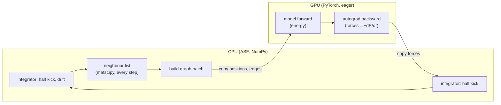
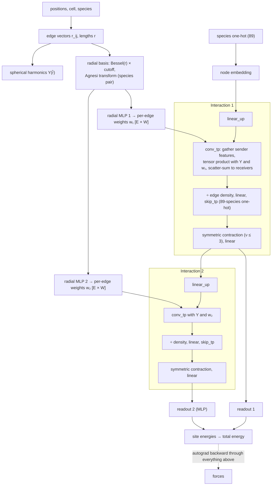
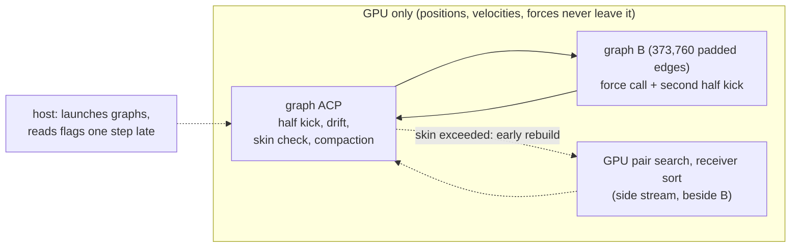
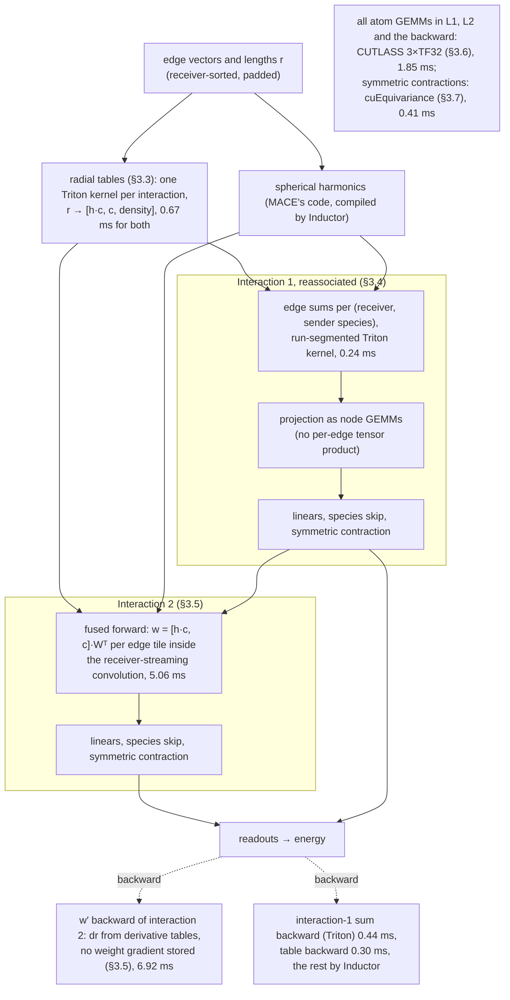

# How FastMACE runs OMAT-0 on the A100, and where each part came from (4 November 2026)

**The run described.** Everything below describes the fastest OMAT-0 run we have recorded:
- **Record:** `results/omat0-a100-profile-20261103/` (source `3501a499`, result commit `57b4f31e`).
- **Model and system:** MACE-OMAT-0 medium on a Modal A100-SXM4-80GB, Benchmark_loup's SrTiO3 10×10×10 (5,000 atoms),
  float32.
- **Protocol:** skin 0.5 Å, 1 fs (`tools/bench/loup_md.py`).
- **Speed:** 3.64 µs/atom/step in NVE and 3.59 µs/atom/step in Langevin (`loup/*.json`). On the A100 PCIe card,
  Symmetrix-XL ran the same benchmark at 5.00 µs/atom/step ([loup-a100.md](loup-a100.md):7). That number is from
  another card and is context, not an A/B.

**Where each part came from.** Every part in §3 carries one of four verdicts:

| Verdict | Meaning |
| --- | --- |
| **COPIED** | External code that we use or vendored. The source is named. |
| **EXTERNAL IDEA** | The idea came from outside (a project, paper, report or review); we wrote the code. |
| **OWN** | The records show that we came up with it, from our own profile, op map or derivation. |
| **UNCLEAR** | No record says where the idea came from. These are listed for investigation in §4. |

**How to read the citations:**
- `path:line` is a file in this repository.
- `RM:LT/path:line` is `Experiments/Langevin_Thermostat/path` in ResearchModule, read at main `d56b5550`.
- "RE" is the research engine in ResearchModule, from 7 to 16 October 2026. FastMACE was extracted from it.

## 1. How standard MACE runs MD

**The MD loop.** ASE drives the loop and calls `MACECalculator` once per step. The CPU and the GPU take turns, and
every step crosses PCIe twice:

**One force call** of a two-interaction model like OMAT-0 medium. Every arrow is one or more separate PyTorch kernels,
and every edge tensor is written to and read back from device memory. The backward then retraces the whole graph
through autograd:

## 2. How FastMACE runs MD

**The MD loop.** The whole step stays on the GPU. Each step replays two captured CUDA graphs:
- **ACP:** half kick, drift, skin check, and compaction of the edge list to the cutoff.
- **B:** forces and the second half kick.

The host only launches and reads flags. A neighbour-list rebuild, when the skin check asks for one, runs on a side
stream beside B. Everything outside the force graph costs about 0.07 ms of the 18.50 ms step
(`breakdown/summary.json`).

**One force call inside graph B** for OMAT-0 on the A100: 178 kernels and 18.4 ms. The numbers are milliseconds per
call from `breakdown/ops.csv`:

**What changed against standard MACE:**

| Standard MACE | FastMACE on this run |
| --- | --- |
| CPU integrator, one PCIe round trip per step | GPU-resident step in two CUDA graphs |
| matscipy neighbour list on the CPU every step | skin list on the GPU, rebuilt only when an atom has moved skin/2, beside the force call |
| Bessel basis + radial MLP per edge, twice | one table lookup per edge and interaction |
| Interaction 1: per-edge tensor product | sums per receiver and species, then node GEMMs |
| Interaction 2: `w₂ [E × 1280]` written, then read by the convolution | `w₂` computed inside the convolution's edge tiles |
| Backward of interaction 2 through `w₂` and the MLP | one kernel using derivative tables |
| cuEq linears and the 89-species `skip_tp` in FP32 | per-irrep GEMMs for the present species only, on 3×TF32 tensor cores |
| eager kernels | `torch.compile` (Inductor) inside our own graphs |

## 3. Each part in detail, and where it came from

### 3.1 MD loop and CUDA graphs

| Part | What it does | Verdict | Evidence |
| --- | --- | --- | --- |
| GPU-resident integrator | ASE's Langevin step term for term on GPU tensors, with the same random stream. | **UNCLEAR** | The RE built it on 7 October 2026. No document says where the idea came from. The earliest note is the RE's "The larger potential optimization is reducing repeated Python/kernel dispatch" (`RM:LT/docs/protocol.md:482`). Measured: NaCl 41.4 → 30.0 ms (`docs/optimisation-ledger.md:495`). |
| Our own CUDA graphs | Each step replays captured graphs. | **EXTERNAL IDEA** (PyTorch CUDA graphs) | The RE read about PyTorch's `reduce-overhead` mode (`RM:LT/docs/protocol.md:484`). That mode failed ("Every second step was 25–30× slower", `RM:LT/docs/implementation.md:160`), so the RE wrote its own capture. Measured: NaCl 30.0 → 16.5 ms, "the single largest step" (`RM:LT/studies/optimization_history/report.md:88`). |
| Padded edge counts in 5 % buckets | B is captured per padded edge count; padding edges lie beyond the cutoff and add exactly zero. There is one size here and no recapture. | **UNCLEAR** | The RE added it on 7 October 2026 (`docs/optimisation-ledger.md:498`). No source is cited. Padding to fixed shapes for CUDA graphs is common practice, so this may or may not be our own idea. |
| Pipelined steps | B is launched before the host reads the rebuild flags, and redone when a rebuild was needed. | **OWN** | Derived from our measured host gap: "The host gap of section 5 …" (`RM:LT/studies/further_optimizations/2026-10-14-third-round.md:229`). Measured: NaCl −3.0 % (`:255`). |
| Rebuild on a side stream (`overlap_rebuild`) | An early rebuild runs beside the force graph. | **OWN** | FastMACE OPT2-T04 diagnosis: "An early rebuild does not …" drain the stream (`docs/validation/opt2-T04.md:21`). |
| Fused integrator (Langevin only) | The Langevin ACP stage as 4 Triton kernels instead of about 45 PyTorch kernels. | **OWN** | FastMACE OPT3-T03, from the owner's "Go ahead and try all kernel opportunities" (`plans/opt-3.md:4-5`). The plan's in-kernel Philox and flags (`plans/opt-3.md:27`) resemble an outside chat's suggestion; that part was not built. |
| 256-step noise batches | One random draw and one copy per 256 steps. | **OWN** | From the RE's profile, where "the GPU waited for the CPU" (`RM:LT/studies/optimization_history/report.md:149`). |
| `torch.compile` mode `default` | Inductor fuses the elementwise chains inside our graphs. | **COPIED** (PyTorch Inductor) | Using it there was the RE's kernel-fusion "Idea 1" (`RM:LT/studies/kernel_fusion/report.md:1`). |
| `unfuse_full_addmm` | Keeps torch 2.14's Inductor from fusing mm + full add into `addmm`, which cost two device copies per step. | **OWN** | The RE's diagnosis on coraline (`docs/optimisation-ledger.md:242`). |

### 3.2 Neighbour list

| Part | What it does | Verdict | Evidence |
| --- | --- | --- | --- |
| Skin (Verlet) list | Pairs within cutoff + skin, rebuilt after skin/2 of displacement; each step compacts to the cutoff. | **EXTERNAL IDEA** (the standard Verlet list) | Textbook technique: "A Verlet skin list stores every pair closer than `cutoff + skin`" (`RM:LT/docs/implementation.md:108`). The 0.5 Å skin is Benchmark_loup's ([loup-a100.md](loup-a100.md):5), the same as Symmetrix-XL's default (`RM:LT/studies/symmetrix_xl/README.md:38`). |
| GPU pair search | One Triton kernel screens all sender × receiver tiles, with float64 pair decisions; the same pairs as matscipy. | **EXTERNAL IDEA, OWN CODE** | GPU rebuilds were raised in our own research prompt, with existing libraries as examples: "torch-nl, vesin, nvalchemi or NVIDIA Warp" (`RM:LT/studies/research_prompts/2026-10-09-hybrid-fp32-optimization-research.md:348-349`). The kernel is ours. Measured: step −1.6 to −4.6 % (`RM:LT/studies/further_optimizations/2026-10-14-third-round.md:64`). |
| Receiver-sorted edges | Edges are sorted by receiver at each rebuild. The streaming convolution and the segmented sum require it. | **UNCLEAR** | The idea first appears in an RE ideas list "proposed on 8 October" (`RM:LT/studies/remaining_optimizations/proposal.md:4`, `:250`). The list names no author. It was committed in a bulk reorganisation (ResearchModule `c733f69e`). |

### 3.3 Radial network → radial tables

| Part | What it does | Verdict | Evidence |
| --- | --- | --- | --- |
| Radial tables (`generic_radial_tables`) | Per interaction and species pair, piecewise Chebyshev series fitted in float64 at setup replace the whole chain r → `[h·c, c, density]` (Bessel, Agnesi, MLP, cutoff). A setup certificate requires the table's float32 error to be at most the float32 network's. | **OWN** | The "external proposal" of 27 October (`docs/validation/opt6-T04.md:21`) was a Claude research session that the owner ran on another account; the chat is kept in [2026-10-27-radial-tables-proposal.md](../design/2026-10-27-radial-tables-proposal.md). **That session found the design itself:** it calls it "The most radical lever I found" and cites no outside source. The design is per species pair, piecewise Chebyshev, on the folded layer's 65-wide input, with the certificate "refuse if the ratio exceeds 1". Its NumPy scripts are in `results/opt6-T04-radial-stub-20261027/table-check/`. **Not copied from the outside spline idea:** Symmetrix-XL uses "cubic Hermite splines (256 knots)" (`RM:LT/studies/symmetrix_xl/README.md:20`), and an outside report proposed a 512-knot Hermite spline. The session tested that spline and rejected it: its r-derivatives were 1.4–34× worse than the float32 network. The OMAT-0 version is a FastMACE finding ("The one worth building", `docs/validation/tiled-omat.md:164`). Measured on the A100: 0.902 / 0.901 ([loup-a100.md](loup-a100.md):46). |

### 3.4 Interaction 1, reassociated

| Part | What it does | Verdict | Evidence |
| --- | --- | --- | --- |
| Reassociation (`generic_reassociate`) | Interaction 1's input is species-only. Its messages are summed per (receiver, sender species) before the last radial layer, then projected with node GEMMs. This removes the first convolution and its per-edge weights. | **EXTERNAL IDEA, OWN CODE** | From an external research report (GPT-6 Pro): "move the first interaction's final radial projection after a receiver-and-species aggregation" (`ResearchModule:GPT_6_PRO_RESEARCH_2.txt:1`), assessed in `RM:LT/studies/research_prompts/2026-10-10-hybrid-default-further-optimization-assessment.md:55`. Measured: NaCl 4.9 %, NaNbO3 7.2 %, NbCl5 4.9 % (`RM:LT/studies/further_optimizations/README.md:55`). |
| Segmented sum (`segmented_first_sum`) | Those sums run as a run-segmented Triton kernel, one atomic per run. | **UNCLEAR** (idea); **OWN** (kernel) | The general idea, "Receiver-sorted edges and segmented aggregation", is in the same unattributed 8 October list (`RM:LT/studies/remaining_optimizations/proposal.md:242`). The concrete kernel is the RE's third-round candidate (`RM:LT/studies/further_optimizations/2026-10-14-third-round.md:45`). |

### 3.5 Interaction 2: streaming convolution, fused forward, w′ backward

| Part | What it does | Verdict | Evidence |
| --- | --- | --- | --- |
| Receiver-streaming convolution kernels | One writer per receiver, with no atomics in the forward; compiled with NVRTC. | **COPIED** (OpenEquivariance PR 223, after the Sobek paper) | Vendored from "OpenEquivariance pull request 223 … by Paul Fuchs", which "adapts the streaming schedule of Chorošajev and Bény, Sobek" (arXiv 2607.18074) (`fastmace/kernels/oeq_streaming/NOTICE.md:3-8`). The owner pointed at the PR (`RM:LT/studies/symmetrix_xl/STREAMED_EDGES_RESULTS.md:121`). Our change is the `ir_mul` layout (`NOTICE.md:12-15`). |
| Fused forward (`generic_fused_folded_forward`) | `w = [h·c, c]·[W, b]ᵀ` is computed per edge tile inside the streaming convolution, instead of an `[E × 1280]` tensor written and read back. | **EXTERNAL IDEA** (Symmetrix-XL), **OWN CODE** | "Origin: the one idea from Symmetrix-XL" (`RM:LT/studies/symmetrix_xl/STREAMED_EDGES.md:7`). The idea "computes `w[e]` from `a[e]` inside the kernel" (`:27-28`). Our kernel is generated from the streaming schedule (round 8, "Owner request", `plans/opt-8.md:3`). On the A100 it is used only together with the w′ backward, because alone it is slower (1.289; pair 0.885, `docs/validation/generic-wprime.md:58`, `:71`). |
| w′ backward (`generic_wprime_backward`) | Within a table piece, `w(r) = Σ_t T_t(x) G_t`. The backward forms `dr = Σ_c dw_c · w′_c(r)` from derivative tables: 10 instead of 65 multiply-adds per weight, with no stored weight gradient and no radial backward. | **OWN** | Derived in our own ideas session: "`dr = Σ_c dw_c · w'_c(r)`" (`plans/ideas-20261027.md:57`; "Side session \"fm-ideas\"", `:3`). The float32 form was an "Owner request, 28 October 2026" (`plans/opt-9.md:3`). It depends on the radial tables (§3.3). |

### 3.6 Atom-level linear layers and GEMM precision

| Part | What it does | Verdict | Evidence |
| --- | --- | --- | --- |
| Per-irrep block GEMMs (`block_linear`) | cuEq `Linear` becomes per-irrep GEMMs with extracted weights. | **OWN** | From the RE's op map, where cuEq's linears were "using slower kernels" (`RM:LT/studies/further_optimizations/2026-10-14-third-round.md:100`). Measured: NaCl −11.8 % (`:117`). |
| Grouped products (`grouped_linear`) | Same-irrep input segments share one product. | **OWN** | The RE's answer to the owner's "optimize OMOL-0 further" (`RM:LT/studies/other_models/README.md:652`, adopted `:721`). |
| Species-restricted skip (`species_skip`) | The `skip_tp` over 89 one-hot elements becomes one GEMM per irrep block for the species present. | **OWN** | From the RE's step breakdown: "about 97% of this multiplies by zero" (`RM:LT/studies/other_models/README.md:282`). Measured on OMAT-0: −20 to −39 % (`:318`). |
| 3×TF32 GEMMs on CUTLASS (`tf32x3_gemms`) | All of the above GEMMs run as error-compensated 3×TF32 on tensor cores, through a prebuilt CUTLASS cubin. Shapes outside the rule stay on cuBLAS IEEE. | **COPIED** (CUTLASS kernel); **EXTERNAL IDEA**; **OWN** integration and shape rule | The kernel is "the 3xTF32 split of CUTLASS example 27" (`fastmace/kernels/cutlass/NOTICE.md:6`). The idea reached us through an external research report, "3×TF32 is worth testing" (`docs/design/2026-10-20-megakernel-research.md:152`), and an external review that started the 29 October screen (`docs/validation/tc-gemm-screen.md:4`). Then: "build it for a100" (`docs/validation/cutlass-tf32x3.md:3`). Measured on OMAT-0: 0.949 / 0.947 (`:86`). |

### 3.7 Backend, symmetric contraction, precision

| Part | What it does | Verdict | Evidence |
| --- | --- | --- | --- |
| Hybrid cuEq + OEq backend | OpenEquivariance for the convolution; cuEquivariance for the symmetric contraction and the rest. | **COPIED** (MACE 0.3.16, OEq, cuEq) | "MACE 0.3.16 can run a model with two accelerated backends at once" (`RM:LT/studies/remaining_optimizations/proposal.md:96`). Adopting it was the user's decision of 9 October (`RM:LT/docs/status.md:7`). |
| Symmetric contraction | cuEquivariance's kernel, unchanged (0.41 ms). | **COPIED** (cuEquivariance) | No rewrite. |
| Float32 with TF32 off, energy summed in float64 | The precision policy; 3×TF32 (§3.6) is the only tensor-core use. | **OWN** (decision) | User production decision, 9 October (`RM:LT/docs/status.md:7`). |

**On in the plan but doing nothing in this run** (no kernels):
- `fused_folded_backward` and `chunked_conv_backward` are on only as prerequisites of §3.3 and §3.5
  (`fastmace/planner/fixed.py:1218`).
- `merged_residual`: "this record stays off" for this model (`breakdown/summary.json:394`).
- `single_graph_strain`: acts only where stress is computed, and this fixed-cell run computes none.

## 4. To investigate: parts whose origin is not recorded

| Part | What is known | Where to look |
| --- | --- | --- |
| Receiver-sorted edges (§3.2) and segmented aggregation (§3.4) | Both are in the 8 October ideas list, which names no author. The first external research report is dated 9 October, one day later. | The session or chat behind `RM:LT/studies/remaining_optimizations/proposal.md` |
| GPU-resident integrator (§3.1) | Built by the RE on 7 October; no source is recorded. | The 1–7 October sessions behind `RM:LT/docs/protocol.md` |
| Padded edge buckets for CUDA graphs (§3.1) | Built by the RE on 7 October; no source is recorded. | Same as the integrator |
